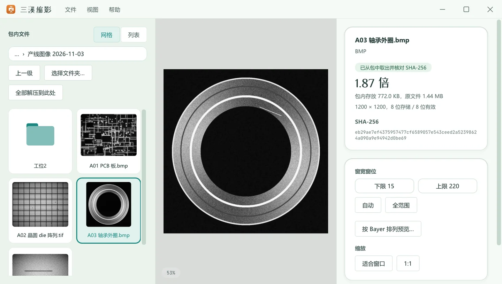
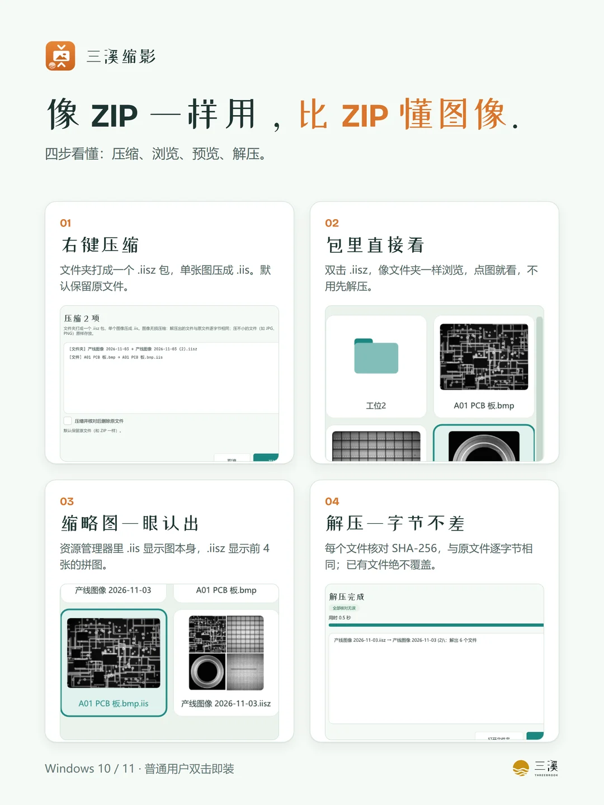
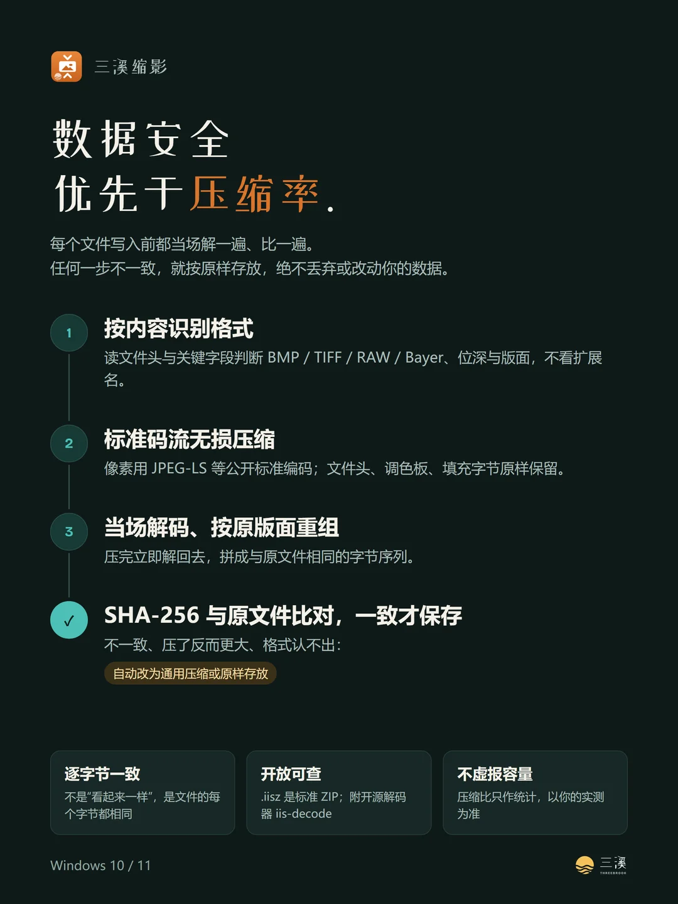
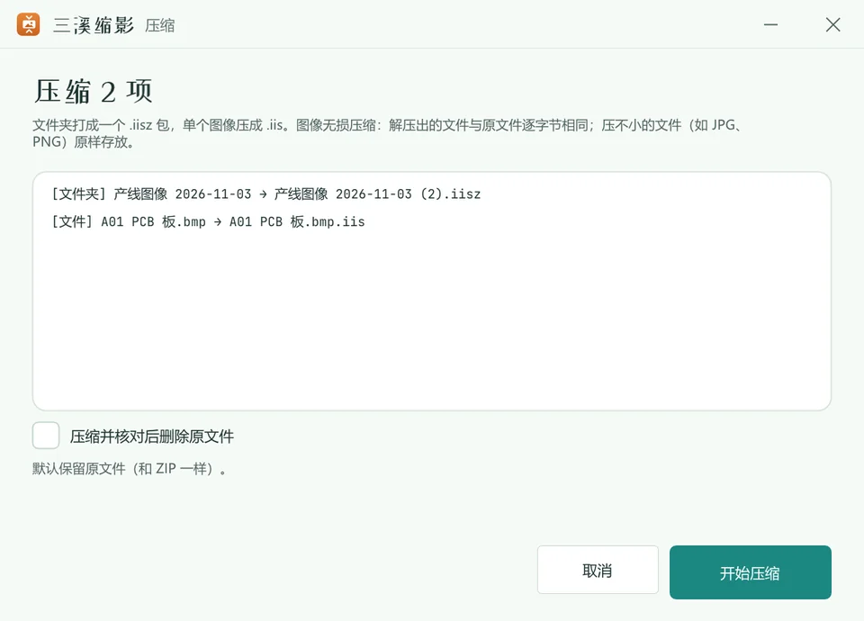
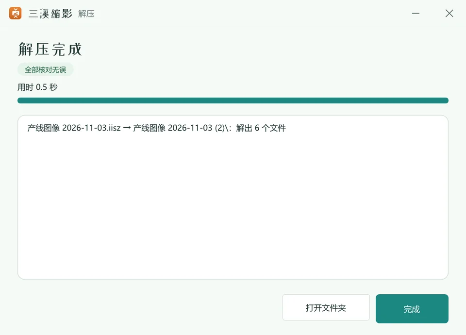
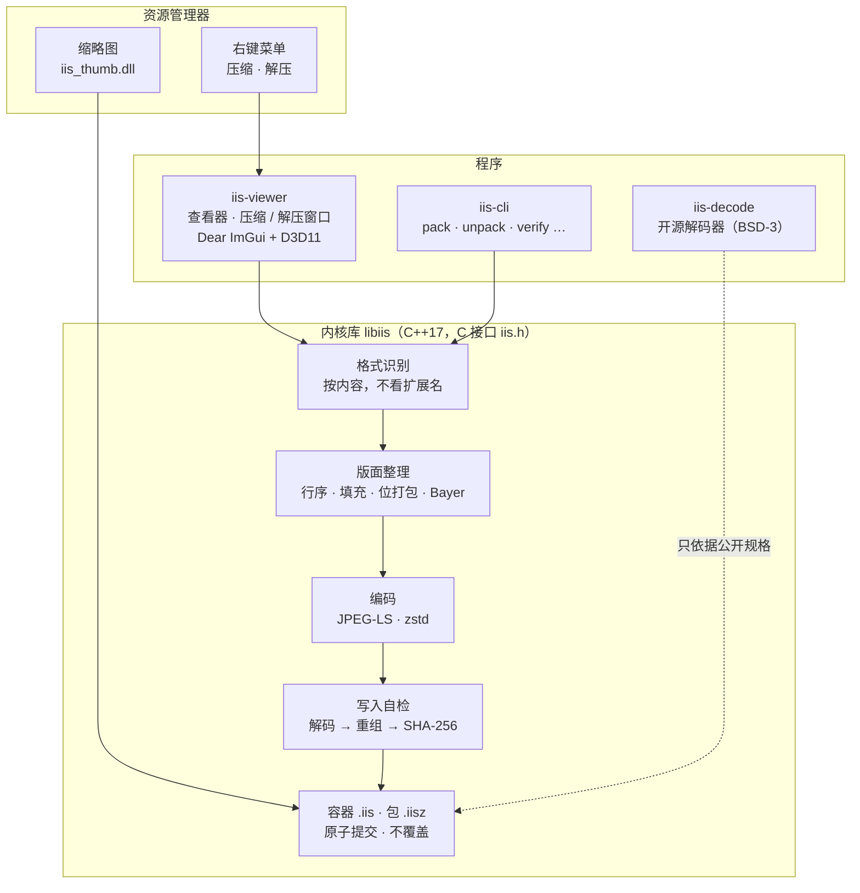
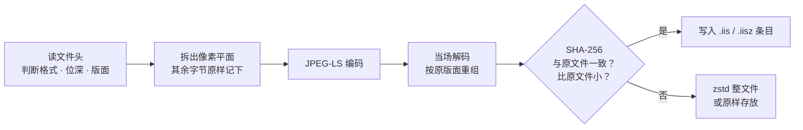
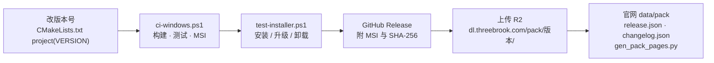

<div align="center">


<h1>三溪缩影 · 源代码</h1>

<h3>工业图像无损压缩，像 ZIP 一样右键就用。</h3>

<p>Windows 上的工业图像压缩工具：BMP、TIFF、RAW 按图像无损压缩，资源管理器里右键压缩、右键解压；<br>解出的文件与原文件逐字节相同，每个文件核对 SHA-256。C++17 内核 + 开源解码器，不联网。</p>


[它做什么](#它做什么) · [现状](#现状) · [架构](#架构) · [代码地图](#代码地图) · [开发](#在-windows-上开发) · [发布](#发布一个新版本) · [约束](#约束) · [下载](https://github.com/ThreeBrook/Threebrook-pack-source/releases/latest) · [官网](https://pack.threebrook.com/)



</div>

> [!IMPORTANT]
> **这是三溪缩影的源代码仓库，版权归三溪 Threebrook 所有，未经许可不得复制或分发。** 例外：开源解码器 [`decoder/`](decoder/)（iis-decode）按 BSD-3-Clause 发布。用户下载和介绍在官网 [pack.threebrook.com](https://pack.threebrook.com/)，安装包也在本仓库的 [Releases](https://github.com/ThreeBrook/Threebrook-pack-source/releases/latest)。

## 它做什么

视觉产线大量用 BMP、未压缩 TIFF 和相机 RAW 存图：不压，硬盘撑不住；用 ZIP 压，又慢又压不小。三溪缩影按图像来压，而且保证解出来的文件和原文件**一个字节都不差**——文件头、调色板、TIFF 标签、行填充字节全部原样保留，拿去重跑检测算法、交给客户审计都没问题。

| 🖱️ 右键压缩 | 🔍 包里直接看 | 🔒 逐字节还原 |
| --- | --- | --- |
| 右键文件夹打成一个 `.iisz` 包，右键单张 BMP / TIFF / RAW 压成 `.iis`；默认保留原文件。 | 双击 `.iisz` 像文件夹一样浏览；资源管理器里 `.iis` 显示图片本身、`.iisz` 显示前 4 张拼图。 | 写入前当场解码比对 SHA-256，一致才保存；解压再核对一次，不一致就报错、不留文件。 |

<table>
<tr>
<td width="50%"></td>
<td width="50%"></td>
</tr>
<tr>
<td align="center"><sub>四步看懂：压缩、浏览、缩略图、解压</sub></td>
<td align="center"><sub>写入即自检：任何一步不一致就原样存放</sub></td>
</tr>
<tr>
<td width="50%"></td>
<td width="50%"></td>
</tr>
<tr>
<td align="center"><sub>压缩前列出每一项会生成什么</sub></td>
<td align="center"><sub>解压完成，全部核对无误</sub></td>
</tr>
</table>

> 截图和海报里的图像都是 `tools/make_demo_images.py` 合成的“产线图像”，不含任何客户样本；用 `marketing\shots.ps1`、`marketing\render.ps1` 重新生成。

**支持的格式**：BMP（8 位灰度带调色板 / 24 / 32 位）；TIFF（未压缩单页 / 多页、条带 / 图块、8~16 位、II / MM、BigTIFF；LZW / ZIP / PackBits 能逐字节复现时才按图像压）；RAW（Mono8 / 10 / 12 / 16、Mono10p / 12p / 12Packed，无文件头时自动识别宽高和像素格式）；Bayer（独立 RAW 或伪装成灰度 BMP / TIFF，拆四相位压缩）。其他文件：压不小的原样存放，其余 zstd 整文件压缩。

## 现状

<table>
<tr><th>项目</th><th>状态</th></tr>
<tr><td><b>Windows</b></td><td>✅ <b>0.3.0</b>（2026-11-03）：右键压缩 / 解压、<code>.iisz</code> 包（标准 ZIP）、查看器（包内浏览、16 位窗宽窗位、Bayer 预览）、资源管理器缩略图、无文件头 RAW 自动识别、命令行 <code>iis-cli</code>、开源解码器 <code>iis-decode</code>、中英文界面、浅色 / 深色、双用途 MSI（双击只装给当前用户，不需要管理员；也可静默装给所有用户）</td></tr>
<tr><td>Linux</td><td>🔧 内核库 <code>libiis.so</code>、<code>iis-cli</code>、<code>iis-decode</code> 能构建、能过测试（<code>scripts/ci-linux.sh</code>），没有图形界面和安装包</td></tr>
<tr><td>官网</td><td>✅ pack.threebrook.com（中英文：首页、下载、帮助、隐私政策、许可协议，官网在单独的仓库）</td></tr>
<tr><td>代码签名</td><td>⏸ 安装包未签名，SmartScreen 可能提示“未知发布者”；签名流程已写好（<code>IIS_SIGN_*</code> 环境变量），等证书</td></tr>
<tr><td>产线自动压缩版</td><td>⏸ 后台服务 <code>iis-service</code>、管理网页、离线授权的代码保留在仓库里，仍构建、仍测试，<b>暂不打进安装包</b></td></tr>
</table>

**价格**：免费，可以把未修改的安装包分享给别人。

## 架构



### 一次压缩



## 代码地图

```
src/
  core/                 内核库 iis.dll / libiis.so：格式处理、版面配方、编解码、容器 v1、包 .iisz、无文件头 RAW 识别（rawguess）
  viewer/               iis-viewer：查看器、右键压缩 / 解压窗口、缩略图处理程序 iis_thumb.dll、中英文（i18n）、三溪外观（theme）
  cli/                  iis-cli：pack / unpack / list / info / verify / restore / compress / export
  service/ license/     后台服务、管理网页、离线授权（保留，暂不打包）
  tools/                开发工具：吞吐测量、负载模拟
decoder/                iis-decode：独立开源解码器（BSD-3-Clause），只依据公开规格，可脱离本仓库单独构建
spec/                   容器格式 v1、包格式 v1、配方 JSON Schema
installer/              WiX 5 MSI（iis.wxs）、使用说明、安装说明
scripts/                ci-windows.ps1 / ci-linux.sh（构建 + 测试）、build-installer.ps1、package-portable.ps1、test-installer.ps1
bench/                  阶段 0 评估工具（Python）：格式识别、多编码器对比、哈希校验、报告；内核的参考实现
tools/                  图标、演示图像、对照与评估脚本
assets/                 图标、界面字体（SIL OFL 1.1）
marketing/              宣传海报（HTML → PNG）与界面截图
docs/                   系统架构、格式处理规范
```

> [!NOTE]
> 不在仓库里的：`build/`、`dist/`（构建和打包产物）、`.cache/`（依赖源码包、WiX）、`samples/`（**客户样本涉及保密，一律不入库**）。

## 在 Windows 上开发

需要 Visual Studio 2022（“使用 C++ 的桌面开发”）。依赖源码包按 `cmake/deps.cmake` 锁定版本和 SHA-256，先在 `.cache/deps/` 找，没有才下载。

```powershell
powershell -ExecutionPolicy Bypass -File scripts\ci-windows.ps1                 # 配置 → Release 构建 → 单元测试 → 生成 MSI
powershell -ExecutionPolicy Bypass -File scripts\build-installer.ps1 -Version 0.3.0   # 只打安装包：dist\ThreebrookPack-<版本>-win-x64.msi
powershell -ExecutionPolicy Bypass -File scripts\package-portable.ps1          # 免安装版：dist\ThreebrookPack-<版本>-免安装版-win-x64\ 与 .zip
powershell -ExecutionPolicy Bypass -File scripts\test-installer.ps1            # 真实安装 / 升级 / 卸载测试（管理员，程序目录放在 .tmp\）
iis-viewer --render 截图.bmp --light | --dark                                    # 不显示窗口，按指定外观截图（自检用）
```

- Linux：`scripts/ci-linux.sh`（Debian bookworm 容器）构建内核、`iis-cli`、`iis-decode` 并跑测试。
- 每个格式处理器都要有往返测试：随机生成各种变体 → 压缩 → 还原 → 哈希一致。
- 第三方依赖和许可证见 [`THIRD_PARTY.md`](THIRD_PARTY.md)；内核与闭源组件不得引入 GPL / AGPL 依赖。
- zlib、libdeflate 的版本不能随意升：复现式还原要求重编码逐字节一致，升级前必须用全部回归样本验证。

## 发布一个新版本



1. 改 `CMakeLists.txt` 的 `project(iis VERSION x.y.z)`，提交。
2. `scripts\ci-windows.ps1` 构建、测试并生成 `dist\ThreebrookPack-<版本>-win-x64.msi`；有证书时设好 `IIS_SIGN_*` 再打包。
3. 管理员运行 `scripts\test-installer.ps1`，两种装法的安装、升级、卸载都要通过。
4. 在本仓库发 Release（标签 `v<版本>`），附 MSI 和 SHA-256。
5. MSI 上传到 R2（`dl.threebrook.com/pack/<版本>/`），从线上下载回来核对校验值；官网仓库改 `data/pack/release.json`、`changelog.json`，运行 `python tools/gen_pack_pages.py`，提交并部署 `pack` 文件夹。

## 约束

> [!WARNING]
> 改代码前必须遵守：
> 1. **数据安全优先于压缩率。** 任何压缩路径失败、校验不通过、格式无法识别，都回退到 zstd 或原样存放，绝不丢弃或修改用户数据。
> 2. **写入即自检。** 提交前必须完成 解码 → 按原版面重组 → SHA-256 与原文件比对，不一致即回退。
> 3. **文件字节无损，不是像素无损。** 文件头、调色板、TIFF 标签、行填充、文件尾附加数据全部原样保留。
> 4. **只用确定性运算。** 可逆路径里只用整数运算，跨平台结果一致；不用浮点或依赖库版本的非确定行为。
> 5. **按内容识别格式，不按扩展名；压了更大就不压。**
> 6. **标准与开放。** 像素流用标准码流（JPEG-LS），容器格式公开（`spec/`），并维护独立的开源解码器。
> 7. **不联网、不覆盖。** 程序不连网络；已存在的文件一律不覆盖；卸载不碰任何图像和压缩包。
> 8. 内部标识沿用旧名（`iis-viewer.exe`、`.iis` / `.iisz`、ProgId `IIS.*`、UpgradeCode、注册表 `SOFTWARE\IIS\Install`），改了会让已装的版本无法升级。

## 协作约定

- 注释、提交说明用中文；注释密度和命名跟周围代码一致。
- 客户样本只放 `samples/`，不提交、不外传；截图和宣传图只用合成的演示图像。
- 外观照三溪外观规范（产品色柿橙 `#D9752B`），界面上的产品名只从 `src/viewer/theme.hpp` 取。

---

<div align="center">

<picture>
  <source media="(prefers-color-scheme: dark)" srcset="https://threebrook.com/lockup-dark.svg">
  
</picture>

<sub>© 2026 三溪 Threebrook · 珠海三溪科技有限公司 · support@threebrook.com<br>未经许可不得复制或分发（开源解码器 decoder/ 除外，BSD-3-Clause）</sub>

</div>
